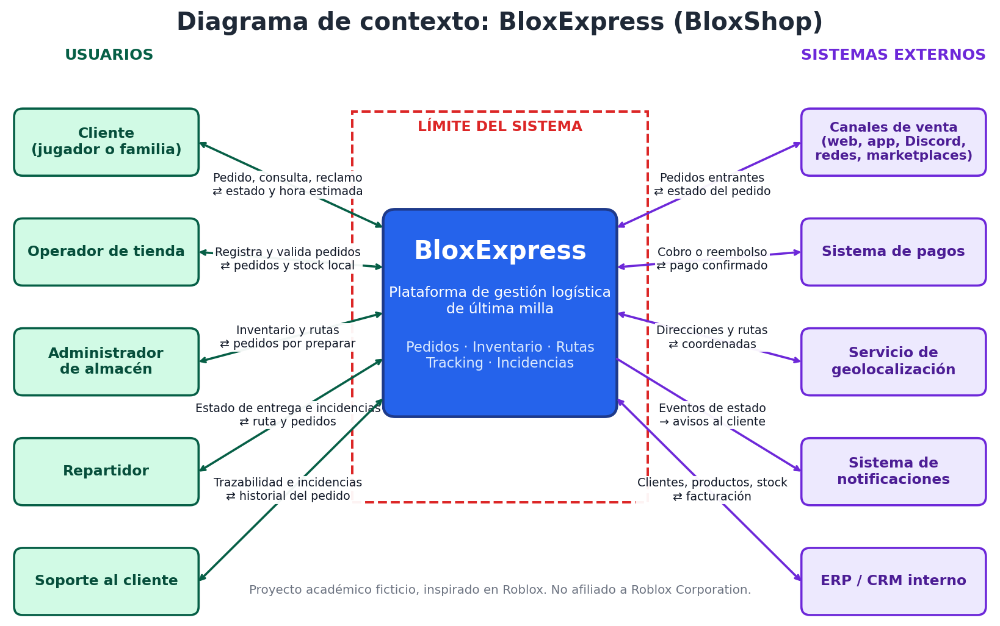
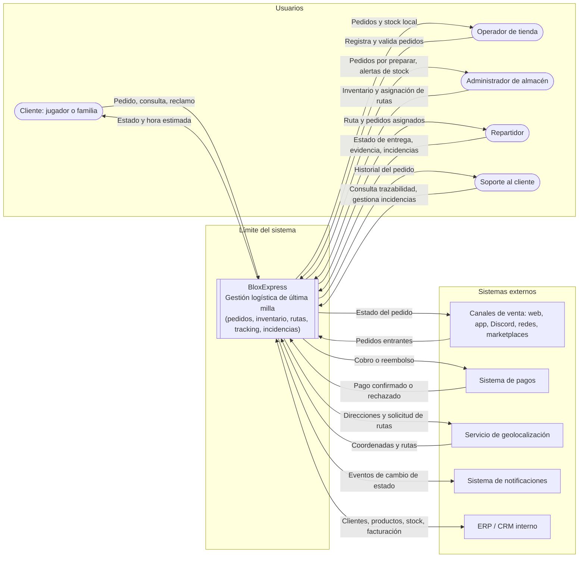

# 03. Diagrama de contexto del sistema

Muestra a BloxExpress como una caja única, los usuarios y sistemas externos que interactúan con ella, los flujos de información y el límite del sistema.

*Versión editable del mismo diagrama (Mermaid, GitHub la renderiza automáticamente):*

## Flujos principales
1. **Pedido:** canal de venta u operador → sistema (valida inventario y pago).
2. **Preparación:** sistema → almacén (pedido por preparar) → sistema (listo para despacho).
3. **Entrega:** sistema → repartidor (ruta) → sistema (estado y evidencia).
4. **Información al cliente:** sistema → notificaciones → cliente.
5. **Incidencias:** cliente, repartidor o soporte → sistema (registro y seguimiento).

## Límites del sistema
- **Dentro:** registro de pedidos, validación de inventario, asignación de rutas, tracking e incidencias.
- **Fuera:** cobro real (pagos), mapas y cálculo de rutas (geolocalización), envío de mensajes (notificaciones), contabilidad y datos maestros (ERP/CRM), y la venta en sí misma (canales).
